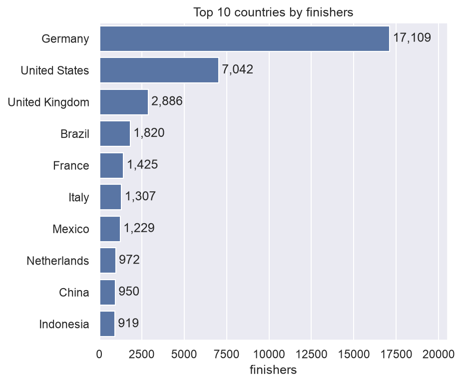
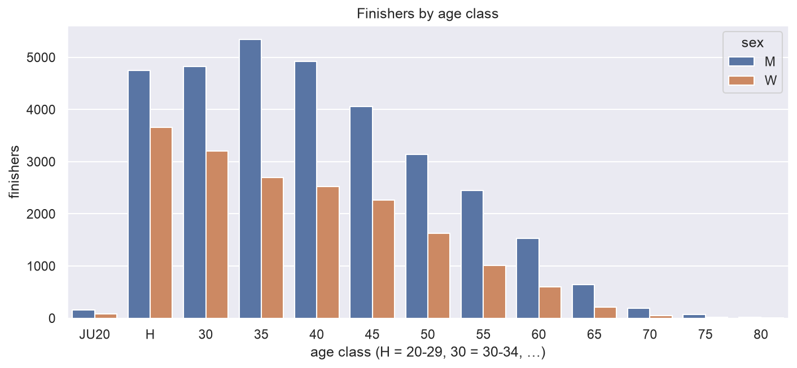
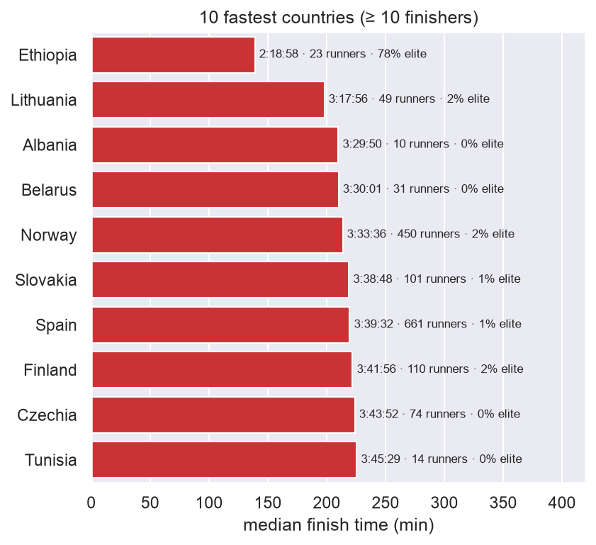
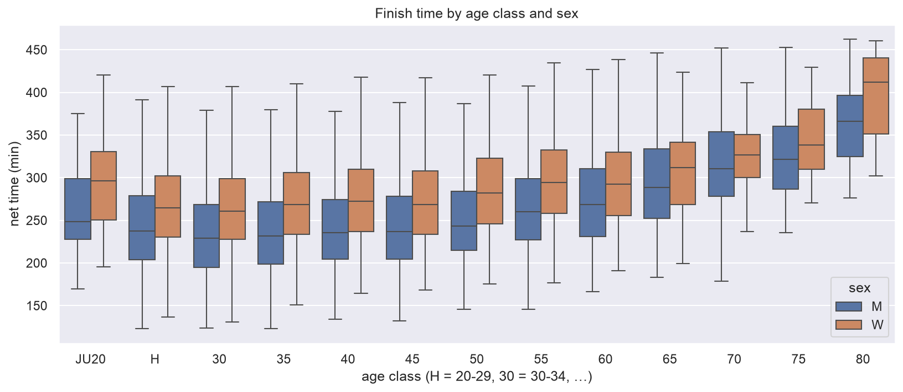
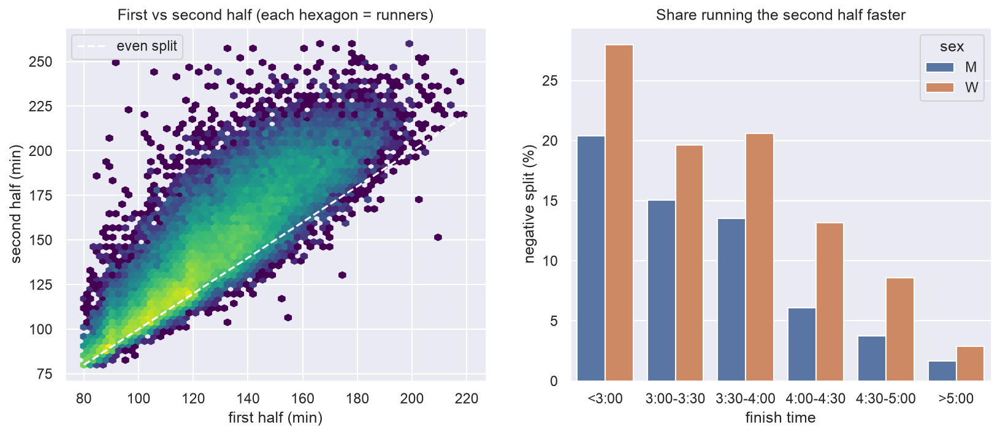
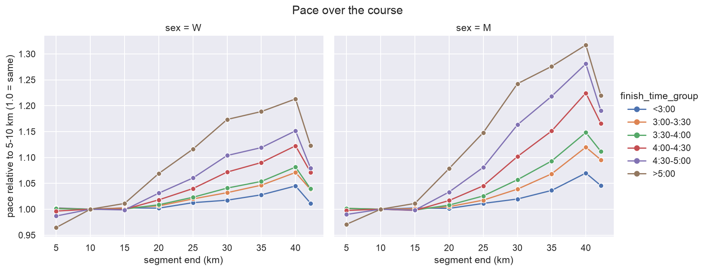
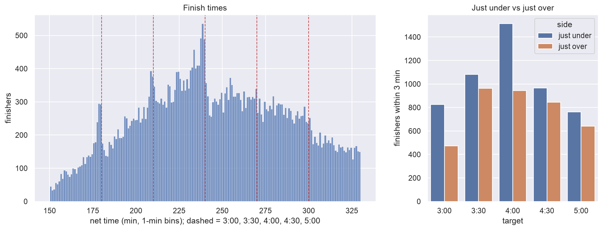
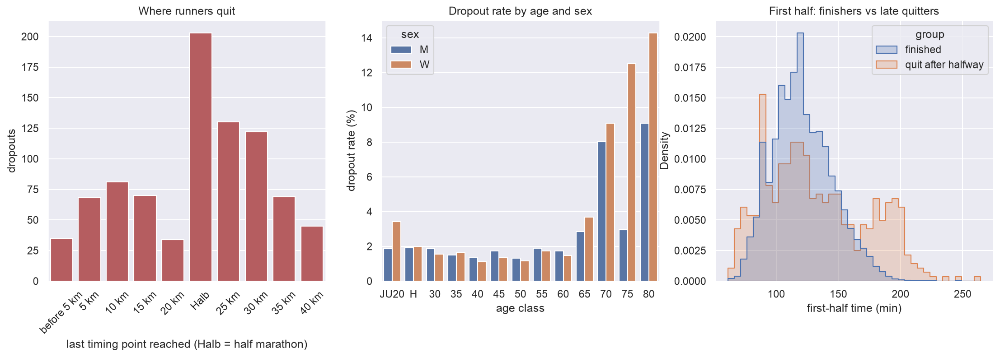

# Analysis & results

Data Science Marathon hand-in: what the results of the BMW Berlin Marathon 2026
tell us about pacing, age and the wall.

← [Back to the main README](../README.md) · Data collection: [marathon_scraper/README.md](../marathon_scraper/README.md)

## View the results

**No Python or data needed:** download [docs/SE_42.html](../docs/SE_42.html) and open it
in a browser (needs an internet connection for the marimo viewer). It is a static export
of the presentation notebook, including code, text, tables and plots.

## Data

- **51,347 runners** and **509,480 split times** (5 km … 40 km, half, finish)
- **Source:** official results, <https://berlin.r.mikatiming.com/2026/>
  (© SCC EVENTS GmbH, timing by mika:timing), collected with the [scraper](../marathon_scraper/README.md)
- the data itself is not part of the repo (see the [disclaimer](../README.md#disclaimer))

| | |
|---|---|
|  |  |

### Where runners come from, and where they are fastest

Interactive world maps (download and open in a browser):
[runners per country](../docs/maps/runners_per_country.html) ·
[median finish time per country](../docs/maps/median_time_per_country.html).



Ethiopia is fastest (median 2:18:58), but only 23 of its runners finished, and 78% of them ran
elite times (men under 2:30, women under 2:50; overall: 0.8%). Small delegations are often
selected athletes, big ones mostly amateurs. Among countries with at least 100 finishers, Norway
(3:33:36) and Slovakia (3:38:48) are fastest.

Map shapes: [Natural Earth](https://www.naturalearthdata.com) 1:50m countries (public domain),
prepared by [scripts/build_world_geojson.py](../scripts/build_world_geojson.py).

## Research questions

### 1 · How do finish times change with age, and does the gap between women and men change?

Men and women are both fastest at 30–34 (median 3:49:02 and 4:20:40), not under 30. After that,
times rise with age, but the spread within each class is large. Up to 55, women's median time is
11–16% slower than men's; from 60 to 79 the gap shrinks to 5–9%.



### 2 · Negative split: who runs the second half faster?

Only 10% of finishers run the second half faster than the first. The faster the runner, the more
likely: 28% of women under 3:00, but only 1.7% of men over 5:00. Women run a negative split more
often than men in every finish-time group.



### 3 · Hitting the wall: where does the pace drop?

Up to 15 km all groups hold their pace (within 1%), then everyone slows down. The slower the group,
the earlier and harder: at 35–40 km men over 5:00 run 32% slower than at 5–10 km, men under 3:00
only 7%. Women slow down less than men in every group. On the last 2 km everyone speeds up again.



### 4 · Round targets: do finish times bunch just under 3:00, 3:30, 4:00 …?

Yes. The histogram has spikes just before the round times. Within 3 minutes of a target, more
runners finish just under than just over at all 5 targets: 1.7× at 3:00 and 1.6× at 4:00. Runners
just under 3:00 also slowed down less in the last 12 km (1.2% vs 2.6%).



### 5 · Dropouts: who quits, where, and did they start too fast?

Only 1.7% of starters do not finish (857 runners). The most common place to quit is halfway (24% of
dropouts). The dropout rate is 1.6% up to 64, but 4.4% from 65 on. "They started too fast" is not
confirmed: runners who quit after halfway were slower in the first half (median 123 min) than
finishers (119 min).



*Also explored in [questions.py](questions.py): overtaking after halfway, start time, country effects,
pacing consistency.*

*The numbers here are copied from the notebook; the notebook computes them from the data.*

## Notebooks

| Notebook | Purpose |
|---|---|
| [SE_42.py](SE_42.py) | presentation / hand-in: dataset, quick facts, selected questions with answers |
| [questions.py](questions.py) | all 9 candidate questions (working notebook) |
| [drafts/quit.py](drafts/quit.py) | draft: first exploration of dropouts |
| [drafts/explore.py](drafts/explore.py) | draft: full table view of all runners |
| [maps.py](maps.py) | world maps (folium): `country_map`, `save_map`, `show_map` |
| [marathon_data.py](marathon_data.py) | shared code: loading, English column names, cleaning rules, analysis columns, `save_figure` |
| [template.py](template.py) | starting point for new notebooks |

Commands (run from the repository root; need `data/marathon.db`):

```bash
uv run marimo edit notebooks/SE_42.py                         # edit
uv run marimo run notebooks/SE_42.py                          # present (slides, code hidden)
uv run marimo export html notebooks/SE_42.py -o docs/SE_42.html   # update the HTML export
```

Plots are also saved as PNGs to [figures/](../figures/) whenever their cell runs.
New notebook: `cp notebooks/template.py notebooks/<name>.py`.
